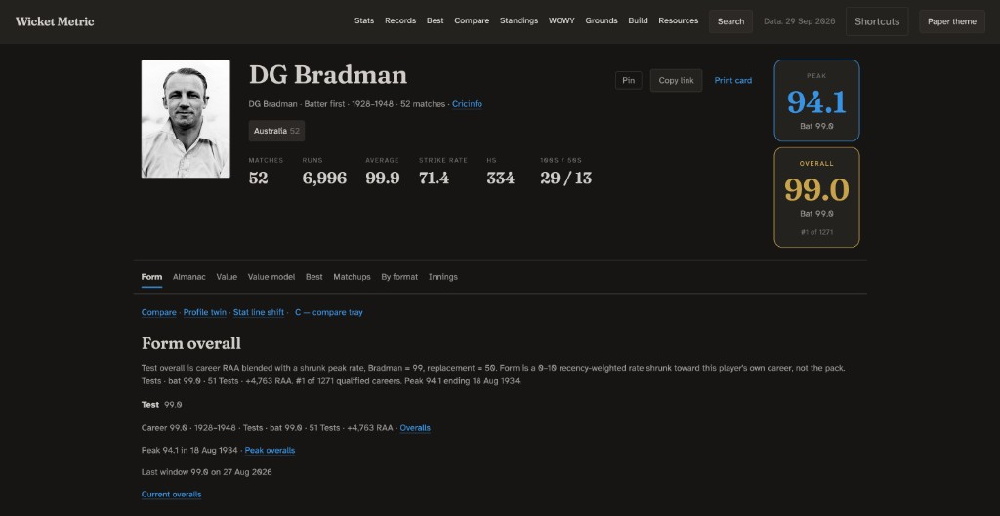
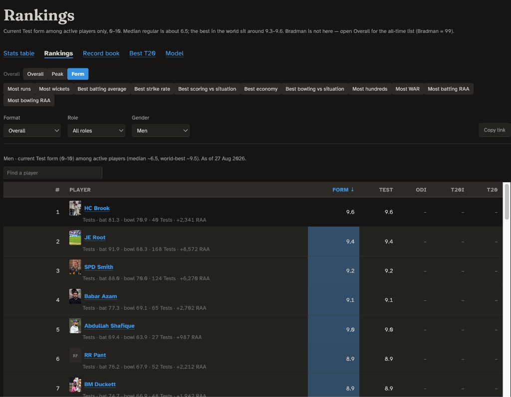
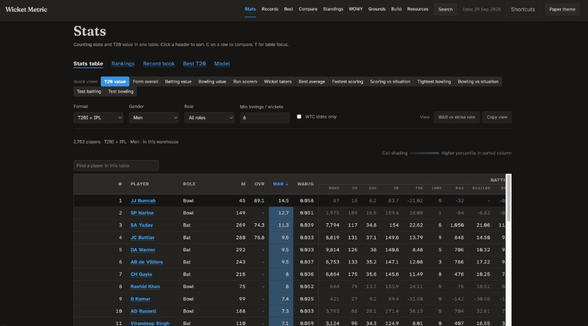
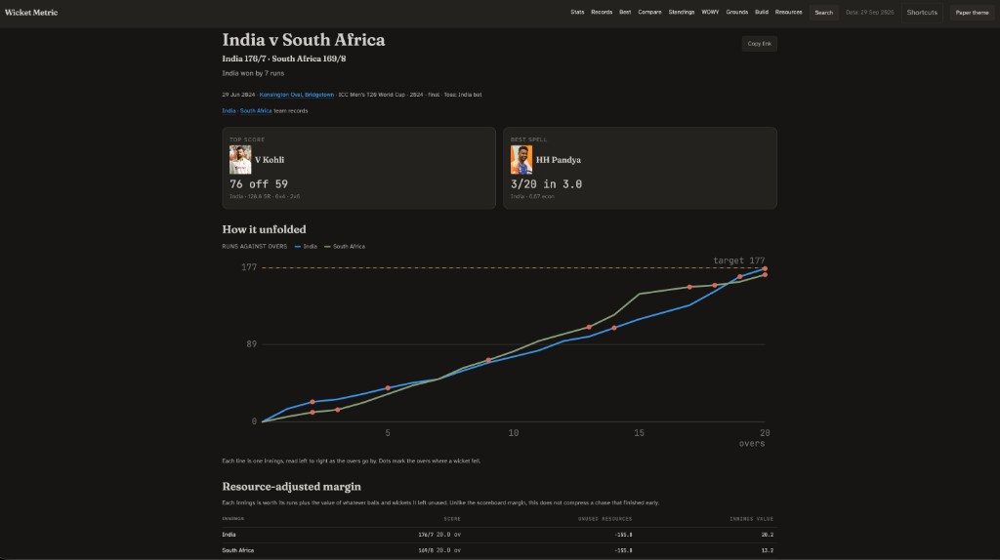
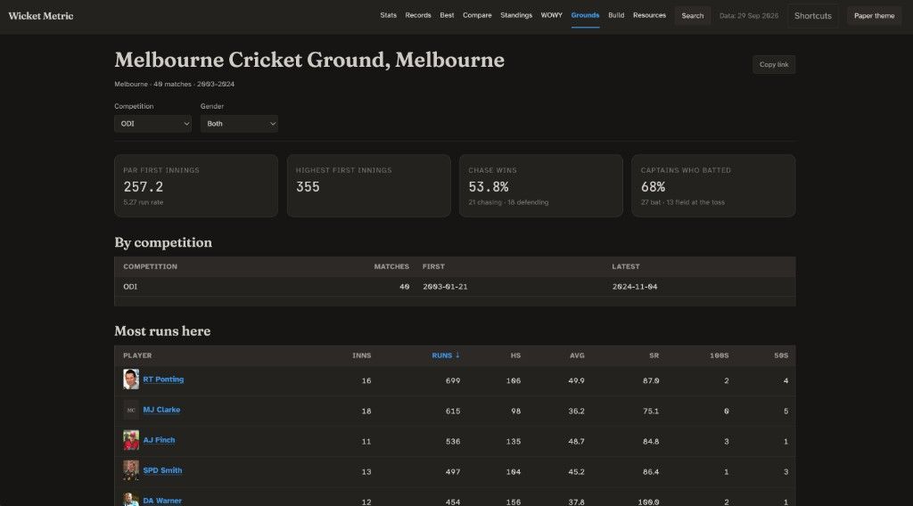

# Wicket Metric

WicketMetric is a local cricket application that loads Cricsheet scorecards, and ranks Test Match careers on runs above replacement and T20 careers on wins above replacement. It displays the results in the browser on your computer.

Test careers are ordered by overall: 40% the z-score of the signed square root of career runs above replacement, 60% the z-score of a shrunk rate, stretched so zero runs above replacement is 50 and Bradman is 99. A name appears with 20 batting innings or 40 wickets. Peak is a separate board, 20% volume and 80% shrunk peak rate, over a window of 730 to 1,825 days with the same innings or wickets floor. Current form is a check. It is a recency-weighted rate on a 0–10 scale, shown only for a player with a match in the last 270 days and at least 10 innings in two years, so a hot month cannot be read as a 99.

T20 careers are ordered by wins above replacement: runs above average, minus a pool-bridge offset, minus a replacement debit, divided by runs per win. Runs per win comes from team-season win share against mean resource-adjusted margin. The match-level logistic is stored as a check, because the sign of a completed innings pair matches the winner on nearly every match and the slope collapses. Strike-rate, economy, and wicket-rate residuals, and the single-innings blend of 0.55 net run contribution, 0.35 win-probability runs, and 0.10 pressure, are printed beside the rank and do not set it. ODI and white-ball counting-stat curves order a column only when you sort by that format. They do not enter Test overall, and franchise T20 does not enter the counting-stat overall. Super overs, and rain-revised innings are left unscored, and the share of those balls is written out. Role and batting position stay out of the T20 baseline. Conditioning on role would define average as average-for-that-role, and replacement would then adjust for role again. Opposition strength stays out of the same baseline. In the application this rule was written against, men's T20I strike rate is 116 against the weakest attacks and 127 against the strongest, so a lower par for weak attacks would pay them more. Strength bands define the pools the bridge joins, and they center the residual. Men and women are fit separately. Fielding stays as catches, run-outs, and stumpings. A caught or stumped wicket still leaks some fielding into bowling value. Cricsheet records neither line and length nor why a no-ball was called, so a free-hit flag before 1 January 2015 is marked approximate. A run-out is charged to the player given out. A retired-hurt batter costs nobody a wicket, which leaves expected remaining runs a little high after they leave.

`pull.py` fetches the Cricsheet register and the match zips. `parse.py` turns each file into scorecard rows, using the dismissal table in `laws.py`, which the worker processes import without loading the model. `build.py` runs that parse in a process pool, writes Parquet to `data/warehouse/`, then calls `standings.py`, `metrics.py`, and `form.py`. `ledger.py` owns the three clocks and the player-event ledger. `resource.py` fits the remaining-runs tables. `expectation.py` fits the out-of-fold baselines. `advanced.py` computes T20 runs above average, replacement, the pool bridge, runs per win, and the audit. `test_value.py` computes Test overall, peak, and form. `form.py` rebuilds those ratings and the ODI and T20 counting-stat snapshots, and the ranking boards read those tables. `cricbase.py` appends innings lines, with no deliveries, for Tests and ODIs Cricsheet does not have. `serve.py` is the FastAPI process. The page in `ui/` and the SQL box may only read the views listed in `db.py`. Write statements are rejected, a query stops at ten seconds, and results stop at 500 rows. Theme and slider weights go to `user_data/` and do not change the application. A pull, build, metric rebuild, or form rebuild started from the page runs as its own process. Tests cover the clocks and the golden over of match 335985, scorecard parsing, synthetic Test calibration, the judgment harness when ratings exist, counting-stat curves, park factors, twins, search, and venue names. Several skip when the IPL dump or the built application is absent. `cricbase-download/tests/` covers Statsguru dates and ingest.

## Run

Python 3.11 or newer.

```bash
python3 -m venv .venv
source .venv/bin/activate
pip install -e ".[dev]"
python -m cricwarehouse pull
python -m cricwarehouse build
python -m cricwarehouse serve
pytest
```

Open http://127.0.0.1:8765.

## Screenshots



Bradman's career overall is 99.0, first of 1,271 qualified Test careers. The peak window, ending 18 August 1934, is 94.1 on the same scale.



Current form is a 0–10 rate among players still active, as of 27 August 2026. Brook leads at 9.6. The all-time list, with Bradman at 99, is the Overall board.



Men's T20I and IPL careers, 2,753 players, sorted by WAR. Bumrah leads at 14.5 across 45 games. TSR and RAA are columns in the same row.



The 2024 men's T20 World Cup final. The scoreboard margin is seven runs. Pricing each innings by the balls and wickets it left unused gives India 20.2 and South Africa 13.2.



Ground pages are built from the scorecards. In ODIs at the MCG in this application, a first innings averages 257.2, and the side chasing has won 21 of 39 decided matches.

## Definitions

In scope: men's and women's Tests, ODIs, and T20Is, plus IPL, WPL, BBL, and WBBL. The Hundred and other domestics are left out. T20 metrics run on T20I, IPL, WPL, BBL, and WBBL only.

### T20 value

A delivery is worth the change in expected remaining runs. First innings use `R(b, w)`, expected runs from balls remaining and wickets in hand. A chase uses `R2(b, w, need)`, capped at the runs still required. `R(0, w)` and `R(b, 0)` are zero, and both tables are forced non-decreasing in balls and in wickets. The gap between chase runs above average under `R2` and under `R` is stored in `chase_distortion`. It is not the rank. The runs-per-win fit uses the target-neutral table for both innings, so unused balls sit on one run scale.

Runs above average subtract what an average player produces from the same balls remaining, wickets in hand, set state (eight balls faced), free-hit flag, and, in a chase, runs still required. The average is an out-of-fold mean: five match folds, seed 20260829, shrunk toward the coarser cell with a prior of 25 events. Batting and bowling stay separate until the audit's all-rounder check passes. If it fails, the column is labeled wins-equivalent.

A run-out costs the side a wicket and is charged to the dismissed player. The bowler gets nothing for it. Retired hurt, retired not out, and absent hurt consume nothing. Retired out, obstructing the field, handled the ball, hit the ball twice, and timed out consume a wicket and go to the unallocated bucket, with byes, leg-byes, penalties, and runs struck past the target. A wide is not a ball faced and does not move the resource clock. A no-ball is a ball faced and does not move the clock. An unmapped dismissal kind consumes a team wicket and credits nobody.

Replacement is the rate of a marginal cohort, chosen from selection history before the outcomes are read: a debut under 300 career balls, a previous season of at most four matches, a gap of three or more years, or at most two matches this season, and not someone with ten or more matches the season before. The rate is pooled over this season and the two before it, weights 1, 0.75, and 0.5, by role. A pool needs 2,000 batter opportunities or 1,500 valid balls. Below a quarter of that floor, or if the cohort rate is above average, replacement falls back to the 25th percentile of shrunk player rates. That fallback is flagged, and the 20th and 30th percentiles are stored beside it. Shrinkage compresses the rate distribution, so the percentile sits high and understates value over replacement.

```
VORP = RAA − bridge − replacement debit
WAR  = VORP / runs_per_win(competition)
```

Runs per win is `4 / β` from team-season win share on mean resource-adjusted margin per match. A competition needs 40 team-seasons of at least 5 games. Otherwise it borrows the gender pool. DLS matches and no-results are left out of the fit. The match-level figure is stored as `match_runs_per_win`.

| Pool | Qualifies when |
| --- | --- |
| IPL, WPL, BBL, WBBL | 60 balls faced or 60 bowled in that player-season |
| T20I | 60 balls in the trailing window, or 100 across the career in the application |
| Career WAR rank | 60 balls faced plus bowled in the pool |
| WAR per game | blank under 20 games |

True strike rate, true economy, true wicket rate, and RAA per 100 stay blank until the filtered pool has the exposure the column asks for. Accumulated RAA and WAR always show, with the ball count.

A single innings or spell is a composite, not WAR. Components are z-scored inside competition, gender, and discipline, then shown as `100 + 10 × (0.55 × NRC + 0.35 × WPA_runs + 0.10 × pressure)`. One hundred is the reference line. Pressure multiplies the run residual by `1 + k × pressure` with `k = 1`.

### Tests

Context is a leave-one-out venue-era scoring rate, then opposition quality, clipped between 0.32 and 2.50 after squaring. Batting and bowling use the same run unit:

```
RAA_bat  = runs × attack quality − 0.75 × context × outs
RAA_bowl = 1.00 × context × wickets × batting quality − runs conceded
```

Retired hurt and absent are not outs. Overall, on the qualified pool:

```
raw     = 0.40 × z(sign(RAA) × √|RAA|) + 0.60 × z(shrunk rate)
overall = 50 + 49 × (raw − raw_at_zero) / (raw_Bradman − raw_at_zero)
```

clipped to 40.0–99.9 and shown to one decimal. Peak uses 0.20 on volume and 0.80 on the shrunk peak rate, on the same anchors. Form's half-life is 365 days. Among active players the median maps to 6.5, the 90th percentile to 8.8, and the current best to 9.6, then clipped to 1.0–9.7. Spin and pace on that board are a hand list in `test_value.py`, not a field in the data.

### Counting-stat form

ODI, T20I, and franchise T20 map a decay-weighted average, strike rate, volume, and hundred or fifty rate through the control points in `form.py` onto 40–99, then shrink short samples. Internationals are limited to World Test Championship sides plus Afghanistan, Ireland, and Zimbabwe. Other associates are left out. Leagues pass through.

| Format | Batting window | Bowling window |
| --- | --- | --- |
| Test | 5 innings and 100 runs | 6 innings, and 10 wickets or 240 balls |
| ODI | 6 innings and 150 runs | 8 innings, and 10 wickets or 180 balls |
| T20I and franchise T20 | 6 innings and 120 runs | 8 innings, and 8 wickets or 96 balls |

### Known Gaps

The Cricsheet data set doesn't have line or length, speed, seam, swing, control %, and no grass, dew or pitch rating. Everything venue related is based of historical residuals. Thus, park factors stop at venue, competition, a rolling window, and set or chase.
